# Arquitectura — Servidor TTS KOKORO

Asistente de voz 100 % local: STT, LLM y TTS corren en la misma máquina, con
interrupción por voz (barge-in) y contexto que solo guarda lo que el usuario
llegó a oír. Este documento describe las piezas, cómo se comunican y los
procesos principales, con diagramas Mermaid (GitHub y VS Code los renderizan).

> Estado a **10-nov-2026**, build del cliente clásico `kokoro-bargein-d-20261110-1`.
> Detalle del protocolo realtime: [REALTIME.md](REALTIME.md). Manual de uso y
> troubleshooting: [MANUAL.md](MANUAL.md). Trazas y métricas: [OBSERVABILITY.md](OBSERVABILITY.md).

## Índice

1. [Vista general](#1-vista-general)
2. [Dos caminos de voz](#2-dos-caminos-de-voz)
3. [Camino clásico (harness `client_example.html`)](#3-camino-clásico-harness-client_examplehtml)
4. [Camino realtime (`/ws/voice`)](#4-camino-realtime-wsvoice)
5. [Máquinas de estado](#5-máquinas-de-estado)
6. [Procesos de resiliencia](#6-procesos-de-resiliencia)
7. [Barge-in y truncado del contexto](#7-barge-in-y-truncado-del-contexto)
8. [Módulos del servidor](#8-módulos-del-servidor)
9. [Latencias y cuellos de botella](#9-latencias-y-cuellos-de-botella)
10. [Decisiones de diseño](#10-decisiones-de-diseño)

---

## 1. Vista general

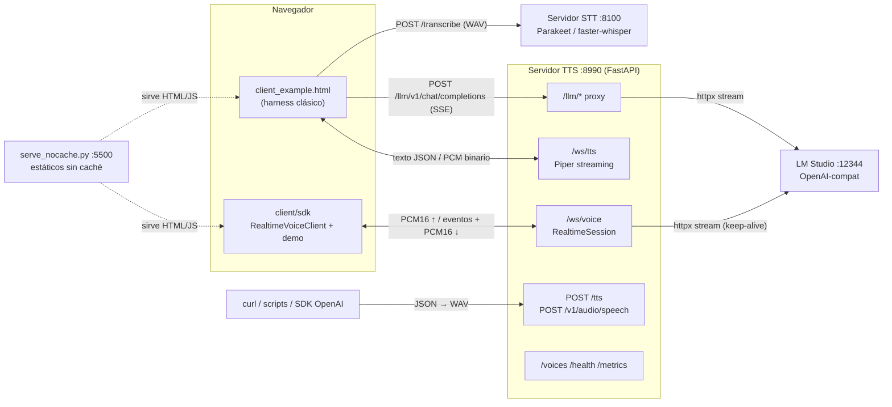

| Proceso | Puerto | Archivo | Rol |
|---------|--------|---------|-----|
| STT | 8100 | `server/stt/stt_server.py` | `POST /transcribe` de WAV completos. Parakeet TDT 0.6B v3 (por defecto) o faster-whisper; el modelo se carga y calienta al arrancar |
| TTS | 8990 | `server/tts/websocket_server.py` | `/ws/tts` (texto→audio), `POST /tts` y `POST /v1/audio/speech` (texto→WAV en una petición), `/ws/voice` (pipeline realtime completo), proxy `/llm/*`, catálogo de voces |
| LLM | 12344 | LM Studio (externo) | Generación en streaming SSE, API OpenAI |
| Estáticos | 5500 | `serve_nocache.py` | Sirve `client/` con `Cache-Control: no-cache`; nunca sirve ocultos (`.env`, `.git`) |

Todo escucha en `127.0.0.1` y CORS solo admite `localhost` / `file://`
(`server/shared/net.py`). Se abre a la LAN con `BIND_HOST` y `CORS_ORIGINS`.

---

## 2. Dos caminos de voz

| | Clásico (`client_example.html`) | Realtime (`/ws/voice`) |
|---|---|---|
| Orquestación | En el navegador (MessageBus + stages) | En el servidor (`RealtimeSession`) |
| VAD | RMS por bloques de 128 ms en JS | Silero ONNX, frames de 32 ms |
| Fin de turno | 700 ms de silencio (slider) | 350 ms + STT especulativo a 128 ms |
| STT | HTTP a :8100 por turno | En proceso, modelo caliente |
| LLM | `fetch` al proxy `/llm` | httpx directo, conexión reutilizada |
| TTS | `/ws/tts` por fragmento | Piper en hilo, mismo WS |
| Conexiones | 3 (HTTP STT, HTTP LLM, WS TTS) | 1 WebSocket full-duplex |
| Primer audio tras callar | ~1.5–3 s (sin razonamiento) | ~0.5 s |
| Uso | Laboratorio: trazas, eventos, DSP, inspección | Producto / SDK reutilizable |

Ambos comparten backends TTS (`server/shared/backends/`), el modelo de
conversación (`server/shared/conversation/`) y el catálogo de eventos
(`shared/events.json`).

---

## 3. Camino clásico (harness `client_example.html`)

### 3.1 Componentes del cliente

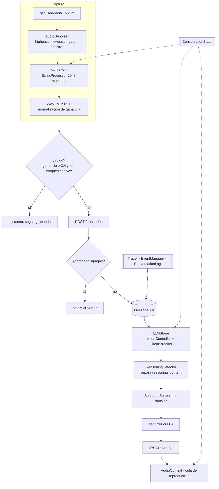

### 3.2 Secuencia de un turno

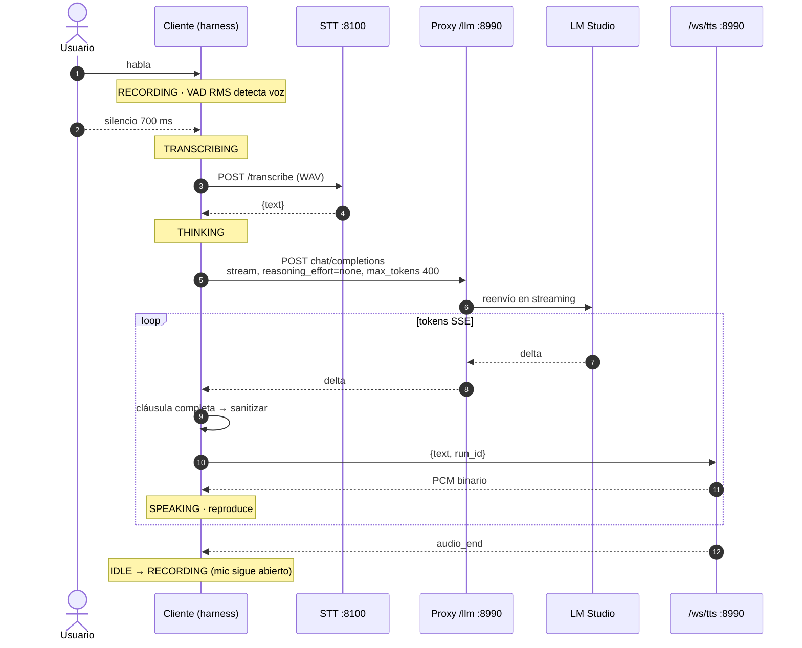

### 3.3 Payload que se envía al LLM

- **System prompt**: el del panel. Si auto-TTS está activo, se le añade el
  estilo de voz (una a tres frases cortas, sin listas, markdown ni emojis, números
  escritos como se dicen), el mismo que usa `/ws/voice`.
- **Historial**: `ConversationLog.toMessages()` con ventana de 20 turnos. El
  razonamiento de turnos anteriores **no** se reinyecta: solo `content`.
- **`reasoning_effort: "none"`** salvo que se marque la casilla
  *Razonamiento del LLM*. Con gemma-4 / qwen3 el razonamiento añadía de 5 a 60 s
  antes del primer token visible.
- **`max_tokens`**: 400 por defecto (slider 100–2000).

---

## 4. Camino realtime (`/ws/voice`)

### 4.1 Pipeline en el servidor

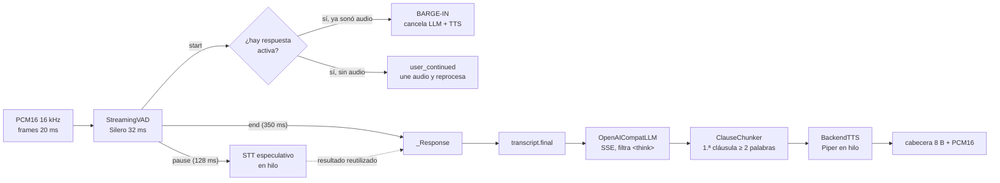

LLM y TTS se solapan: Piper sintetiza la cláusula 1 mientras el LLM genera la 2.

### 4.2 Secuencia con barge-in

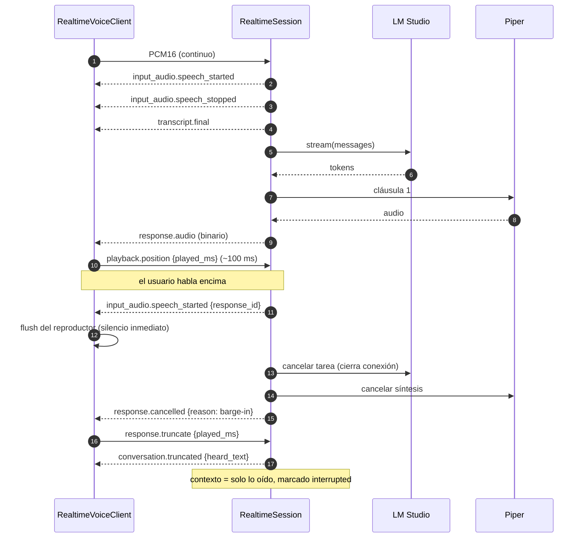

---

## 5. Máquinas de estado

### 5.1 `ConversationState` (cliente clásico)

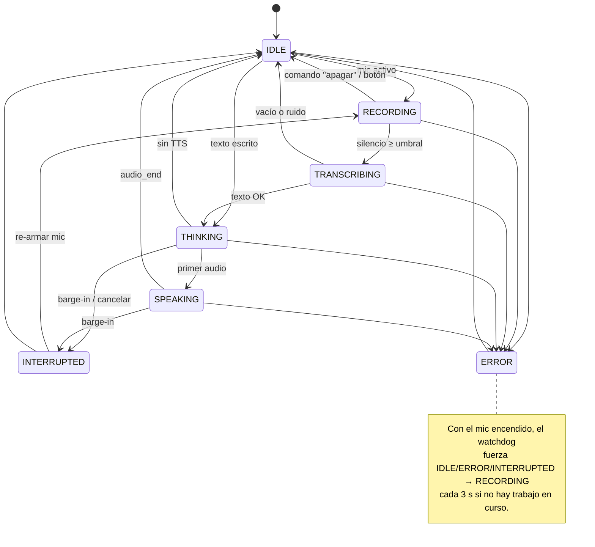

Las transiciones fuera de la tabla `TRANSITIONS` se registran y se ignoran;
`force()` se usa solo para recuperaciones (watchdog).

### 5.2 Circuit breaker del LLM

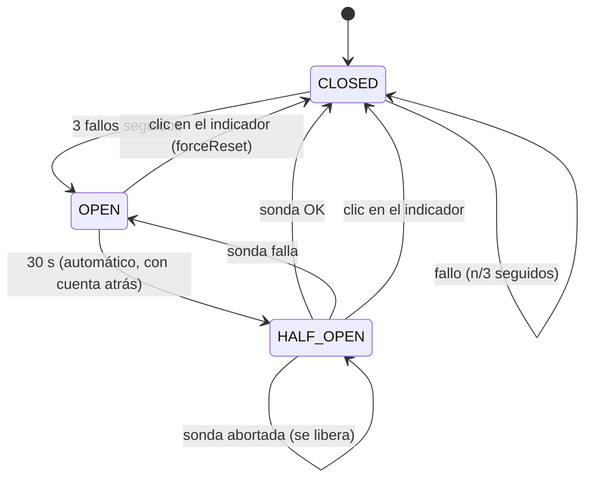

- Cuenta como **éxito** recibir `fetch OK` del LLM; como **fallo**, que el
  pipeline falle (`reason` del último paso queda como `lastError`).
- Las interrupciones (barge-in, cancelar, `confirm()` rechazado) **no** cuentan
  como fallo: llaman a `recordAborted()`.
- Indicador: verde `CLOSED (sano)`, amarillo `CLOSED (n/3 fallos seguidos · último: …)`,
  rojo `OPEN — reintento en Ns`, `HALF_OPEN` mientras se prueba.

### 5.3 Turno en `RealtimeSession`

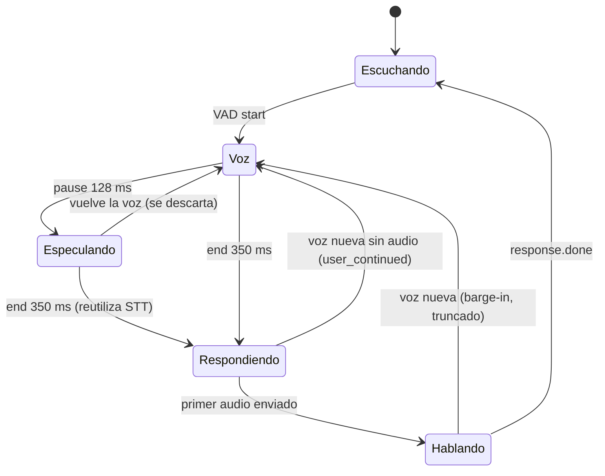

---

## 6. Procesos de resiliencia

### 6.1 Micrófono siempre encendido (cliente clásico)

El micrófono solo se apaga por decisión del usuario: botón con el ratón o
comando de voz. Todo lo demás se recupera solo.

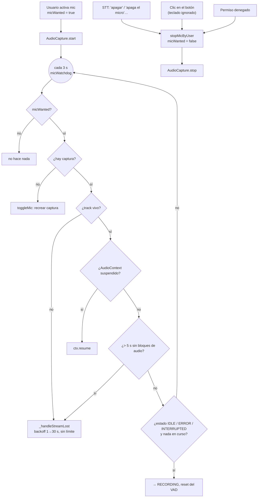

**Comando de voz** (`isMicOffCommand`): normaliza acentos y puntuación, y
acepta como máximo 6 palabras.

- Basta el verbo solo: *apaga / apagar / apágate / apaguen / desactiva(r)*.
- Con sustantivo obligatorio: *detén, para, cierra, corta* + *el/tu micro,
  micrófono, mic, audio, escucha*.
- Muletillas permitidas: *oye, ok, vale, por favor* antes; *ya, ahora, por
  favor* después.

Ejemplos: «apaga el micrófono, por favor» apaga el mic; «para» o «apagar la luz
de la cocina ahora mismo» no.

**Por qué**: antes, un Espacio/Enter con el botón enfocado apagaba el micro sin
querer, los reintentos se agotaban a los 8 y un error del STT dejaba el estado en
`ERROR` sin volver a grabar.

### 6.2 WebSocket TTS

Reconexión con backoff 2→4→8→16→30 s, *fence* por `run_id` (se descartan
mensajes y frames binarios de runs anteriores) y pre-calentado del
`AudioContext` en el primer clic (política de autoplay de Chrome).

### 6.3 Servidor

- STT: modelo cargado y calentado en el `lifespan`; `/health` indica `model_loaded`.
- Realtime: con `REALTIME_PRELOAD=1` se calientan Parakeet, Silero y Piper y se
  pide 1 token al LLM para que LM Studio cargue el modelo (JIT).
- `localhost` → `127.0.0.1` en la URL del LLM: en Windows `localhost` resuelve a
  `::1` primero y cada conexión nueva perdía ~2 s.

---

## 7. Barge-in y truncado del contexto

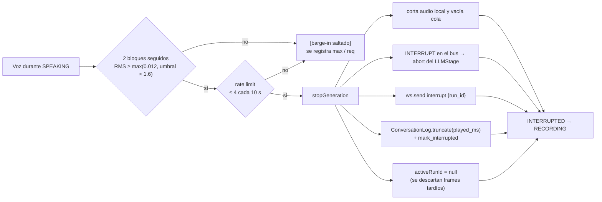

En el camino realtime el proceso es equivalente, pero lo decide el servidor
(Silero) y el truncado se hace con `heard_text()` sobre los segmentos de audio
realmente reproducidos (`server/realtime/chunker.py`).

---

## 8. Módulos del servidor

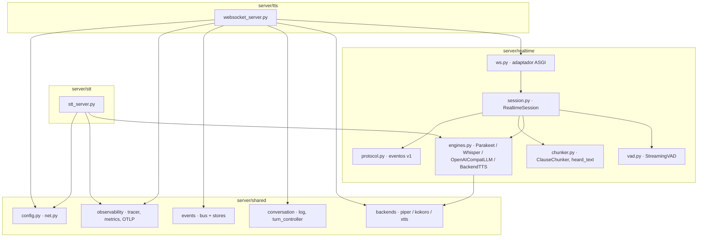

- `server/realtime/` no depende de FastAPI: `RealtimeSession` recibe
  `send_json` / `send_bytes` y motores intercambiables (ver [REALTIME.md](REALTIME.md)).
- Los backends TTS siguen el patrón Strategy (`TTSFactory`); Piper es el de por
  defecto y sintetiza en streaming (genera audio por fragmento, sin esperar la frase).
- Event store intercambiable: memory, jsonl, sqlite, postgres, sqlserver
  (`EVENT_STORE_BACKEND`).

---

## 9. Latencias y cuellos de botella

Medidas en CPU (i7-11700), Piper, Parakeet int8 y `gemma-4-e2b` en LM Studio.

### Camino realtime (`python tests/test_voice_ws_e2e.py`)

| Etapa | Tiempo |
|-------|--------|
| Overhead del gateway por frame (p50 / p99) | 0.4–0.9 / 1.2–1.3 ms |
| Barge-in en servidor (voz → cancelado) | ~5 ms |
| STT tras fin de turno | ~0.5 ms (especulativo) |
| LLM primer token (en caliente) | ~190 ms |
| TTS primer chunk | 50–70 ms |
| Fin de turno → primer audio | **~480 ms** |

### Camino clásico (log del harness, nov-2026)

| Etapa | Antes | Ahora / esperado |
|-------|-------|------------------|
| Fin de voz detectado | 700 ms de silencio | igual (configurable) |
| STT HTTP | 600–850 ms (1.ª: 11.5 s, modelo cargando) | igual; el 1.º turno tras arrancar paga la carga |
| LLM `fetch OK` → primer chunk | **6–59 s** (razonamiento + historial inflado) | sin razonamiento: del orden de 0.2–1 s |
| Longitud de respuesta | hasta ~1500 caracteres con listas | 1–3 frases (estilo de voz, 400 tokens) |

**Cuello de botella principal**: el LLM. Recomendaciones en LM Studio (no se
tocan desde el código):

- *Max concurrent predictions* / parallel en **1–2** (con 4 el modelo reparte CPU).
- Mantener el modelo cargado (desactivar el TTL de descarga o cargarlo fijo).
- Un modelo más pequeño u offload a GPU reduce directamente el tiempo hasta el primer audio.

---

## 10. Decisiones de diseño

| Decisión | Motivo |
|----------|--------|
| Proxy `/llm/*` en el servidor TTS | Un único punto de entrada al LLM: trazas, cancelación upstream y CORS controlado |
| Parakeet TDT 0.6B v3 por defecto | WER 2.5 % vs 26 % de whisper tiny y ~16× más rápido que whisper small en CPU |
| `reasoning_effort: none` por defecto | Los modelos con razonamiento retrasaban el primer token decenas de segundos |
| No reinyectar razonamiento en el historial | Cada turno procesaba más prompt y el modelo imitaba el formato `[reasoning]` |
| Corte por cláusula (no por frase) | El TTS arranca con 2–6 palabras en vez de esperar la frase completa |
| Micro gobernado por `micWanted` + watchdog | El estado del micro depende de la intención del usuario, no de eventos del navegador |
| Breaker que no cuenta aborts | Interrumpir al asistente es uso normal, no un fallo del LLM |
| Fusionar turnos consecutivos del mismo rol | Gemma exige alternancia estricta user/assistant |
| Todo en `127.0.0.1` por defecto | El proxy LLM no debe quedar expuesto en la red sin querer |
